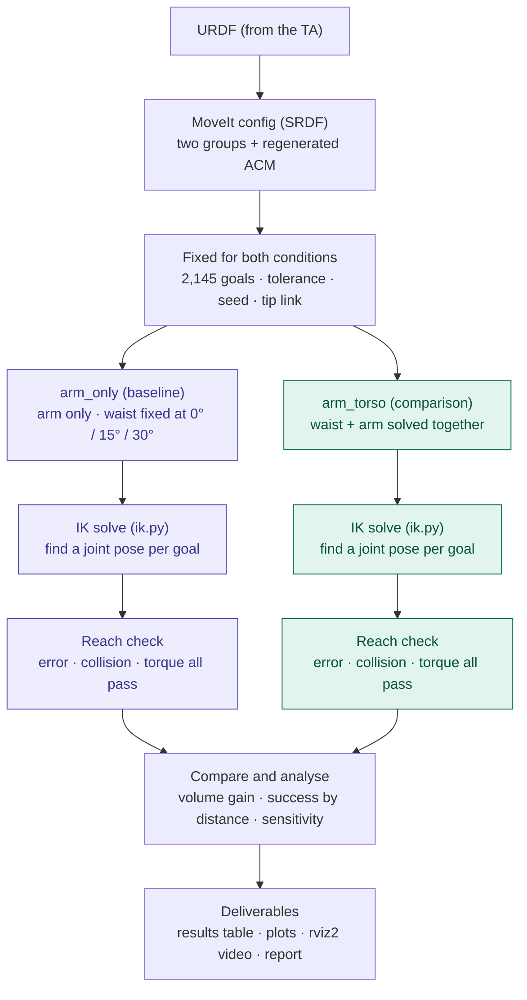

# armteam

Whole-body reach study for the **INDEX01** upper-body humanoid, built with ROS 2 Jazzy, MoveIt 2 and Gazebo.

## Goal

Measure in simulation how much larger the region INDEX01's fingertip can reach becomes when the **waist is solved together with the arm** (whole-body control), compared with the arm alone.

INDEX01 has no mobile base and its torso is fixed to the floor, so walking balance (ZMP) is out of scope.

## Experiment

Two MoveIt planning groups that differ **only** by the waist joints:

| Group | Joints | Role |
|---|---|---|
| `arm_only` | shoulder → wrist | Baseline (waist fixed) |
| `arm_torso` | waist joints + the same arm joints | Comparison (waist solved together) |

Both groups get the same goal grid, tolerance and grid spacing. A goal counts as reached only if all three hold:

- position error ≤ tolerance
- no self-collision
- peak torque ratio (joint torque ÷ limit) ≤ 1.0

**Key metrics:** reachable-volume gain (`arm_torso` ÷ `arm_only`), success rate per 0.1 m distance bin, max reach, self-collision count (must be 0).

### Task structure



The two lanes run the exact same pipeline. The only difference is the group name passed to the IK solver, so any gap in the results comes from the waist.

### Rules that keep the comparison valid

- Both groups must use the **same tip link**. The code cannot check this, so verify it in the SRDF.
- **Regenerate the ACM** (Allowed Collision Matrix) after adding `arm_torso`. Otherwise reachable volume is overestimated.
- Never change the goal set, tolerance or grid spacing between the two conditions.
- `MockIk` is for pipeline testing only. Never report its results.

## Environment

| Component | Version |
|---|---|
| OS | Ubuntu 24.04 LTS (native install; Windows / WSL2 not supported) |
| ROS 2 | Jazzy |
| MoveIt | 2 (`ros-jazzy-moveit` binaries) |
| Simulator | Gazebo + `ros_gz` |
| Middleware | CycloneDDS (`rmw_cyclonedds_cpp`) |

A dedicated GPU is not required; integrated graphics can run rviz2.

### What each component does

| Component | Role |
|---|---|
| Ubuntu 24.04 | The only OS with ROS 2 Jazzy / MoveIt 2 binaries |
| ROS 2 Jazzy | Framework that lets robot programs (nodes) exchange messages |
| CycloneDDS | Middleware that carries ROS 2 messages; the whole team must use it |
| MoveIt 2 | IK, motion planning, collision checking, Setup Assistant (SRDF + ACM) — the core tool |
| rviz2 | 3D view of the robot and its plans; visualisation only, no physics |
| Gazebo + ros_gz | Physics simulator, bridged to ROS 2 |
| ros2_control | Same control interface for the simulator and the real robot |
| colcon / rosdep | Build the workspace and install package dependencies |
| numpy, PyYAML, matplotlib | Run the experiment, read configs, plot results |
| XFCE + TigerVNC + noVNC | Browser desktop to see rviz2 / Gazebo on RunPod |

The **URDF** (from the TA) describes INDEX01's links, joints and limits. The **SRDF** adds the planning groups and the collision matrix. Details: [`ENVIRONMENT.txt`](ENVIRONMENT.txt).

### RunPod template (recommended)

The environment is baked into a Docker image, so every new pod starts ready to use. No install step.

- **Image:** `ghcr.io/ddongs068/armteam:latest`, built from [`Dockerfile`](Dockerfile) by GitHub Actions whenever `requirement.txt`, `run_requirement.sh` or `docker/` changes on `main`.
- **Base:** `runpod/base:1.0.3-ubuntu2404` (RunPod's official Ubuntu 24.04 image: SSH, Jupyter and the web terminal work as usual).

Create the template once in RunPod (**Manage → My Templates → New Template**):

| Field | Value |
|---|---|
| Container image | `ghcr.io/ddongs068/armteam:latest` |
| Container disk | 30 GB |
| Volume mount path | `/workspace` |
| Expose HTTP ports | `6080` (browser desktop), `8888` (Jupyter) |
| Expose TCP ports | `22` (SSH) |
| Env (optional) | `VNC_PASSWORD`, `START_GUI=0` to skip the desktop |

Then deploy pods from that template. On start, `docker/pod_start.sh` creates `/workspace/ros2_ws` (first start only, it persists), clones this repo into it and starts the desktop. Open HTTP port **6080** from the Connect menu, then `vnc.html` (default password `armteam`).

> One-time setup: after the first workflow run, open the `armteam` package on GitHub (**Profile → Packages → armteam → Package settings**) and set its visibility to **Public** so RunPod can pull it.

### Quick start without the template (plain Ubuntu 24.04 pod or machine)

Use a pod whose base image is **Ubuntu 24.04**, then:

```bash
git clone https://github.com/DDongs068/armteam && cd armteam
bash run_requirement.sh              # full install + browser desktop for rviz2 / Gazebo
bash run_requirement.sh --headless   # no GUI, enough for the IK sweep
```

- [`requirement.txt`](requirement.txt) lists every apt package by section. To add one, put it in the right section and re-run the script.
- The script sets CycloneDDS in `~/.bashrc` and creates a workspace at `/workspace/ros2_ws`.
- **Every new pod:** RunPod wipes the container disk on restart (`/workspace` survives), so run `bash run_requirement.sh` again. Packages that are already installed are skipped.
- For the GUI, run `~/start_gui.sh` and open HTTP port **6080** from RunPod's Connect menu (expose port 6080 on the pod).

### Manual setup

1. Install ROS 2 Jazzy by following the [official guide](https://docs.ros.org/en/jazzy/Installation.html).
2. Install MoveIt 2, CycloneDDS and the Gazebo bridge:

   ```bash
   sudo apt install ros-jazzy-moveit ros-jazzy-rmw-cyclonedds-cpp ros-jazzy-ros-gz
   echo "export RMW_IMPLEMENTATION=rmw_cyclonedds_cpp" >> ~/.bashrc
   source ~/.bashrc
   ```

   **Everyone on the team must use CycloneDDS.** Nodes on different middleware cannot talk to each other.

3. Check the install:

   ```bash
   ros2 topic list                  # runs without errors
   echo $RMW_IMPLEMENTATION         # rmw_cyclonedds_cpp
   ros2 pkg list | grep moveit      # MoveIt packages are listed
   ```

When reading docs, make sure they are for **Jazzy**, not Humble. Package names and APIs differ between distributions.

### Robot model

**URDF (Unified Robot Description Format)** is an XML file that describes a robot's physical structure. It defines the robot's links (rigid parts such as the torso, upper arm and hand), the joints that connect them, each joint's limits (angle range, speed, torque), and the shapes used for display and collision checking. ROS tools read this file to understand the robot: MoveIt uses it to compute joint angles and check collisions, and rviz2 and Gazebo use it to draw and simulate the robot.

The INDEX01 URDF is provided by the TA. Place it under the workspace `src/`. Joint count, reach and torque limits are taken from the URDF only, because they are not published anywhere else.

Joint and link names are read from `config/planning_groups.yaml`, not hard-coded. When the URDF arrives, edit only that file so the names match the SRDF.

### Build and run the MoveIt demo

```bash
cd ~/<workspace>
colcon build --packages-select <robot>_moveit_config
source install/setup.bash
ros2 launch <robot>_moveit_config demo.launch.py
```

## Measurement conditions

Fill in this table before reporting any result. Results cannot be interpreted without it.

| Item | Value |
|---|---|
| Tolerance | 0.01 m (default) |
| Grid spacing | 0.1 m |
| Goal count | 2,145 |
| Planner | |
| Seed | |
